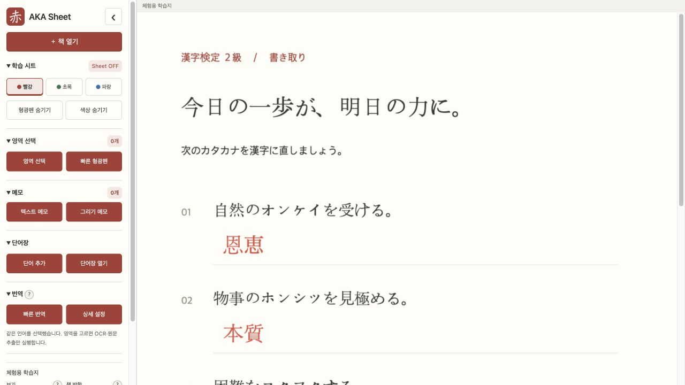
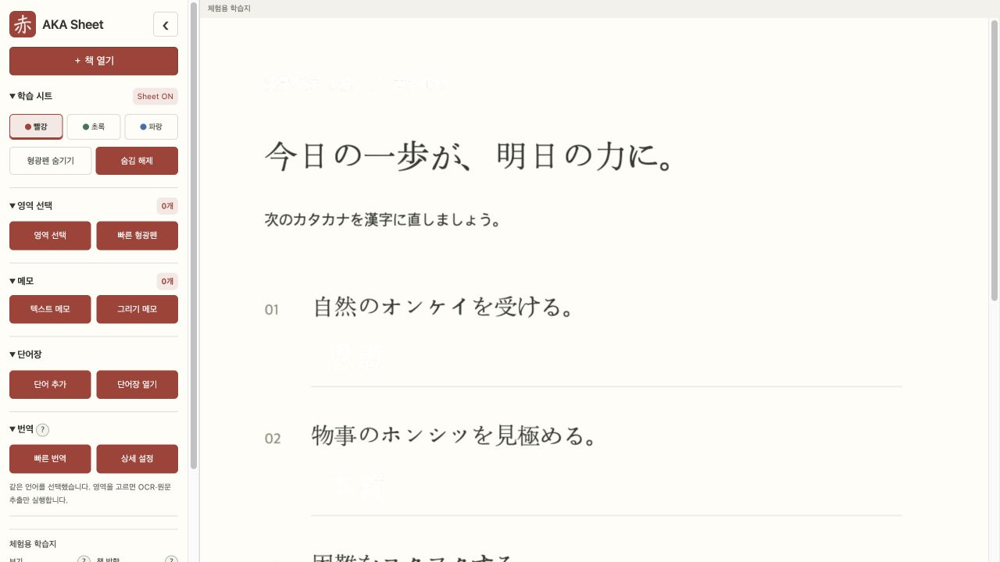

> **Google Drive 동기화 베타 · 1.8.1-beta.1**
> 이 브랜치는 `beta/google-drive-sync`입니다. 공개 `main`은 1.2.2이며, 모바일 UI와 그리기 모드를 함께 반영했습니다. Drive 동기화는 베타에만 포함합니다. 별도 [웹 베타](https://aka-sheet-drive-beta-7k29.g-flow.chatgpt.site/)에서 여러 기기 검증을 진행합니다. 기존 서비스의 기록은 자동 이전되지 않습니다. [베타 실행·설정 안내](docs/GOOGLE-DRIVE-BETA.md)

<p align="center"></p>

# AKA Sheet

한국어 · [English](README.en.md) · [日本語](README.ja.md)

**책의 정답을 가리고, 선택한 부분을 읽고 기록하는 오프라인 지향 학습 리더.**

일본어 한자 학습서의 빨간 정답을 디지털 적색 시트로 가리고 싶다는 필요에서 시작했습니다. PDF·EPUB·이미지 위에서 색상 숨김, OCR, 번역, 형광펜, 메모, 사전, 단어장으로 학습을 이어갈 수 있도록 확장한 개인 프로젝트입니다.

**[앱 체험하기](https://akai-sheet-beta-local-7k29.g-flow.chatgpt.site/)** · **[설계와 문제 해결](docs/PORTFOLIO.md)** · [버전 이력](public/releases.js) · [1.0.0 검증 기록](docs/QA-1.0.0-2026-11-16.md)

현재 베타 버전 **1.8.1-beta.1** · HTML / CSS / JavaScript · PWA · 브라우저 내 OCR·번역

UI 언어는 **설정 → 메뉴 UI → 앱 표시 언어**에서 선택하며 다음 앱 실행부터 적용됩니다. OCR·번역·사전 언어와 독립적이고, 기존 책·메모·단어장 내용은 번역하거나 변경하지 않습니다. [i18n 구조와 검증](docs/I18N.md)

## 화면

앱에 직접 제작해 넣은 체험용 학습지를 사용했습니다. 사용자 책이나 개인 데이터가 포함되지 않은 실제 실행 화면입니다.

| 정답 표시 · Sheet OFF | 빨간색 숨김 · Sheet ON |
|---|---|
|  |  |

## 빠르게 체험하기

1. [앱을 열고](https://akai-sheet-beta-local-7k29.g-flow.chatgpt.site/) 기본 예제를 확인합니다. 책 파일 없이 시트 기능을 시험할 수 있습니다.
2. 학습 시트에서 빨강을 선택하고 **색상 숨기기**를 눌러 빨간 정답을 가립니다.
3. 본인의 PDF·DRM 없는 EPUB·이미지·이미지 ZIP/폴더를 열어 학습합니다.
4. **영역 선택**에서 OCR·형광펜·메모·번역·사전·단어장으로 이어갑니다. 각 모델·사전 데이터의 준비 여부와 기기 지원에 따라 사용할 수 있는 기능이 다릅니다.

첫 접속과 모델·사전 준비에는 인터넷이 필요합니다. OCR 모델은 초기 준비 과정에서 다운로드되며, 대형 번역 모델과 사전팩은 사용자가 선택해 준비합니다. 이후 준비된 자원을 오프라인에서 재사용합니다. 브라우저 저장소 정리, 지원 API 차이, 미설치 데이터 때문에 모든 환경에서 모든 기능을 보장하지는 않습니다.

## 주요 기능

| 기능 | 구현 내용 |
|---|---|
| 책 읽기 | PDF, EPUB, 이미지, 이미지 ZIP/폴더 · 한/두 페이지 · 좌/우 읽기 방향 · 휠/스와이프/탭 이동 |
| 학습 시트 | 빨강·초록·파랑 다중 선택 · 원본 색상 및 형광펜 숨김 |
| 영역 활용 | 텍스트 추출 또는 OCR · 선택 위치의 결과 팝업과 후속 작업 |
| 학습 기록 | 형광펜 · 텍스트/그리기 메모 · 위치 탐색기와 검색 |
| 언어 학습 | PaddleOCR/Tesseract · 기기 내 번역 · 선택 설치형 한·영·일 사전 · 여러 단어장 |
| UI 언어 | 한국어·영어·일본어 · 시스템 언어 감지 · 설정에서 선택 · 다음 실행부터 적용 |
| 개인화·저장 | 메뉴 표시/순서/접힘 · 단축키 · 마지막 읽기 위치 · 수동 백업/복원 · 지원 환경의 선택 폴더 자동 저장 |

## 기술 구성

| 영역 | 기술과 역할 |
|---|---|
| UI·문서 표시 | Vanilla JavaScript, HTML, CSS, Canvas, PDF.js, EPUB sandbox, JSZip |
| OCR·번역 | Web Worker, WebAssembly, ONNX Runtime Web, PaddleOCR, Tesseract.js, Transformers.js, 지원 환경의 브라우저 번역 API |
| 오프라인·저장 | Service Worker, Cache Storage, IndexedDB, localStorage, 지원 환경의 File System Access API |
| 검증·배포 | Node.js 회귀 검사, 브라우저 검증 기록, Git 버전 이력, ChatGPT Sites 정적 호스팅 |

사용자가 학습 흐름·UX·우선순위를 정하고 AI 코딩 도구와 함께 구현·수정·검증한 프로젝트입니다. 외부 엔진 자체를 개발한 것이 아니라, 학습 리더 안에 통합하고 기기 내에서 실행하는 흐름을 만들었습니다. 구체적인 선택과 한계는 [개발 사례](docs/PORTFOLIO.md)에 정리했습니다.

## 로컬 실행

이 저장소는 빌드 과정이 없는 HTML/CSS/JavaScript 앱입니다. 저장소를 받은 뒤 프로젝트 폴더에서 실행합니다.

```sh
python3 -m http.server 8765 --bind 127.0.0.1 --directory public
```

브라우저에서 `http://127.0.0.1:8765/`를 엽니다. 파일을 직접 더블 클릭하는 `file://` 방식 대신 HTTP 서버를 사용하세요. 사이트 주소·브라우저·포트가 바뀌면 별도 저장소로 취급되므로 필요한 사용자 데이터는 백업 파일로 옮깁니다.

## 폴더 구성

| 경로 | 내용 |
|---|---|
| `public/` | 앱 정적 원본 및 로컬 실행 파일 |
| `server/` | Google 권한 갱신 서버 |
| `dist/` | 빌드로 생성되는 배포 결과물 |
| `tests/` | 기능·저장·오프라인 회귀 검사 |
| `docs/` | QA 결과와 검증 범위 |
| `scripts/` | 사전 데이터 생성·가공 스크립트 |
| `licenses/`, `public/licenses/` | 외부 구성 요소의 이용 조건 |
| `.openai/hosting.json` | 기존 Sites 배포 대상 설정. 인증 정보는 포함하지 않음 |
| `VERSIONING.md`, `BETA-PLAN.md` | 버전 정책 및 개발 이력 |

## 검사

Node.js와 npm이 설치된 환경에서 프로젝트 폴더에서 실행합니다.

```sh
npm ci --prefix tests --ignore-scripts
for f in tests/*.cjs; do node "$f" || exit 1; done
for f in public/*.js; do node --check "$f" || exit 1; done
```

사전팩을 변경했을 때는 추가로 `python3 tests/dictionary-packs.py`를 실행합니다. 자동 검사는 실제 모바일/Windows 기기 QA를 대신하지 않습니다.

## Git 및 배포

- `main`: GitHub에서 확인하는 현재 릴리스 소스와 관리 문서
- `beta/local-translation`: 기존 개발 브랜치
- `v1.0.0` 등 버전 태그: 각 앱 릴리스의 소스 경계. 이전 개발 이력을 그대로 보존합니다.
- GitHub는 소스·변경 이력 관리용이며, **서비스 호스팅은 기존 ChatGPT Sites를 유지**합니다. GitHub에 올리는 것만으로 자동 배포되지 않습니다.
- Sites 배포는 `.openai/hosting.json`의 기존 프로젝트를 사용합니다. 별도 안정판 사이트에 임의로 병합하거나 배포하지 않습니다.
- GitHub 원격 이름은 `github`입니다. 기존 `origin` 연결은 보존합니다. 작업 커밋을 만든 뒤 `git push github beta/local-translation`으로 개발 브랜치를 올립니다. 릴리스 태그는 의도적으로 지정해 푸시합니다.

앱 코드와 데이터팩에는 서로 다른 외부 라이선스가 적용됩니다. NLLB는 실험용·비상업 옵션이며 가중치를 자동 다운로드하지 않습니다. 외부 구성 요소의 기존 고지와 사전 출처를 유지하세요. 공개 저장소 전환은 앱 자체에 MIT 등 재사용 라이선스를 부여하는 것을 의미하지 않습니다. 앱 자체의 별도 라이선스는 아직 지정하지 않았으며, 외부 구성 요소와 사전 데이터의 권리는 각 원저작자에게 있습니다. [외부 출처와 라이선스](THIRD_PARTY_NOTICES.md)를 확인하세요.

페이지 전체에 필기하는 그리기 모드와 이동 가능한 도구 창을 지원합니다. 설정 → 메뉴 UI에서 기존 영역 그리기 메모로 전환할 수 있습니다.
