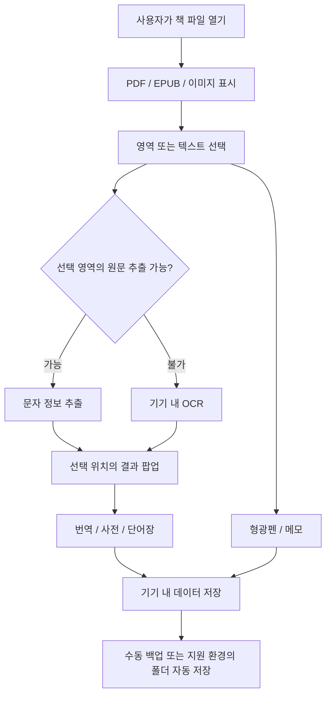

# AKA Sheet · 설계와 문제 해결

[앱 체험](https://akai-sheet-beta-local-7k29.g-flow.chatgpt.site/) · [프로젝트 소개](../README.md) · [개발 이력](../dist/releases.js)

## 출발점과 목표

일본어 한자 학습서는 빨간 정답을 적색 시트로 가리며 공부하도록 구성되어 있습니다. 전자책에서도 같은 방식으로 공부하고, 인식·번역·기록 때문에 다른 앱으로 자주 이동하지 않도록 만드는 것이 출발점이었습니다.

목표는 책을 사용자의 기기 안에서 처리하는 학습 리더입니다. PC와 모바일에서 같은 웹 코드를 사용하며, 앱과 필요한 데이터가 준비되면 오프라인에서 재사용하도록 설계했습니다. 최초 설치부터 인터넷이 필요 없는 배포 형태나 모든 OS에서 동일한 파일 접근 권한을 갖는 네이티브 앱은 아닙니다.

## 역할과 개발 방식

개발자는 학습 문제 정의, UX 요구사항, 우선순위, 디자인 피드백과 릴리스 판단을 맡았습니다. AI 코딩 도구와 함께 구현·회귀 검사·브라우저 확인을 반복했습니다. OCR·번역·PDF 엔진과 사전 데이터는 외부 오픈소스 및 공개 데이터를 활용했습니다. 모델을 직접 학습하거나 인식 엔진 자체를 만든 프로젝트로 소개하지 않습니다.

## 핵심 선택

| 문제 | 선택한 방식 | 이유와 남은 제약 |
|---|---|---|
| 스캔본과 텍스트 문서의 차이 | 선택 영역에서 원문 추출 또는 OCR | 문자 정보가 있으면 재인식을 줄이고, 이미지에서도 같은 후속 작업에 접근합니다. 세로쓰기·혼합 레이아웃의 품질은 문서에 따라 다릅니다. |
| 학습 시트와 선택 기능의 충돌 | 가림 상태를 캡처·추출 경로에도 반영 | 숨긴 정답이 OCR·복사로 다시 나타나는 문제를 줄입니다. 관련 검사는 `tests/`와 버전 기록에서 추적합니다. |
| 클릭·스와이프·영역 선택의 충돌 | 선택 작업과 페이지 이동의 이벤트 분리 | 읽기 방향과 수직 스크롤 방향을 구분하고, 작업 중 잘못된 페이지 넘김을 막습니다. |
| OCR 준비 시간의 불확실성 | Worker 실행, 모델 캐시, 작업 단계와 상태 표시 | 모델 다운로드·엔진 준비·인식 단계를 구분합니다. 첫 실행 비용과 기기별 성능 차이는 남습니다. |
| 배율·페이지 배치가 바뀌는 주석 | 페이지 기준 좌표로 형광펜·메모 관리 | 화면 크기보다 책의 위치에 기록을 연결합니다. 메모 이동·크기 조절·탐색을 같은 기록 위에서 제공합니다. |
| 기기 간 브라우저 파일 권한 차이 | 공통 백업/복원 + 지원 환경의 선택 폴더 자동 저장 | 브라우저 내부 저장과 외부 파일 저장을 구분합니다. 모든 모바일에서 자동 파일 저장을 지원한다고 주장하지 않습니다. |
| 무거운 번역·사전 데이터 | 모델·언어별 선택 설치와 삭제 | 필요 없는 데이터 비용을 줄입니다. 캐시가 삭제되면 다시 준비해야 합니다. |

## 처리 흐름

형광펜과 메모는 영역 좌표만으로도 생성할 수 있습니다. 텍스트가 필요한 조회·번역·단어장에서는 문서의 문자 정보 또는 OCR을 사용합니다. 외부 OCR·번역 서버로 책 내용을 보내지 않는 방식입니다.

## 검증과 근거

- [1.0.0 QA](QA-1.0.0-2026-11-16.md): 메뉴 사용자화, 숨김/복귀, 설정 이관, 실제 PDF 상태 유지, 메모 초안 보호와 백업 복원 등을 기록했습니다.
- [이전 QA](QA-2026-11-06.md): 이전 시점의 검증 범위와 한계를 확인할 수 있습니다.
- [회귀 검사 코드](../tests/): 저장·설정·선택·주석·사전·모델 캐시 등의 조건을 코드로 남겼습니다.
- [릴리스 로그](../dist/releases.js): 기능 추가와 수정 내역을 버전별로 관리합니다. 초기 버전 일부는 대화 기록을 바탕으로 소급 정리했으며 [버전 정책](../VERSIONING.md)에 명시했습니다.

실제 iOS/Android 펜·터치, Windows 실기기, 모든 교재의 OCR 정확도, 장기 캐시 유지까지 검증 완료한 상태는 아닙니다. 기존 QA는 당시 환경에서의 결과이며, 이번 공개 준비는 문서·이미지 정리 작업으로 앱 기능을 바꾸지 않았습니다. 성능 향상률·정확도·사용자 수처럼 측정하지 않은 수치는 제시하지 않습니다.

## 다음 개선 방향

- 실제 모바일·Windows 기기와 다양한 문서에서 호환성·정확도 확인
- 사용자 데이터 복구와 저장 상태의 신뢰성 개선
- 페이지 전체 번역 등 무거운 기능은 학습 흐름과 성능을 검증한 뒤 확장

공개 저장소는 소스와 개발 과정을 공유하기 위한 것이며, 현재 서비스는 기존 ChatGPT Sites에서 운영합니다.
